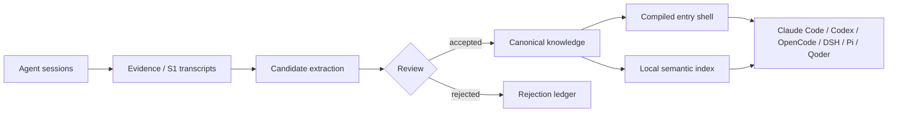

# SSOT Kit

[](https://github.com/AksuRedapple/ssot-kit/actions/workflows/ci.yml)
[](LICENSE)

**Persistent, local-first knowledge governance for multi-agent coding workflows.**

SSOT Kit turns scattered agent sessions into an inspectable system: canonical Markdown knowledge,
small compiled agent entry files, resumable session records, one-way promotion, and local semantic recall.
Everything runs on the user's machine; this repository contains framework code and templates, never personal content.

[中文说明](README.zh-CN.md) · [Architecture](docs/ARCHITECTURE.en.md) · [Quick start](docs/QUICKSTART.md) · [Changelog](CHANGELOG.md)

**Field notes:** [可换届的组织 — the Agent organization & state-governance series](https://ouya15.cn/insights/series/org-governance.html)

## The problem

Long-running coding agents fail in three quiet ways:

1. **Memory truncates silently.** Oversized `CLAUDE.md` / `AGENTS.md` files are cut off, usually removing the newest and most relevant rules.
2. **Sessions stop being resumable.** After dozens of sessions, nobody can tell which one owns a task, what was tried, or what was rejected.
3. **Knowledge loses its address.** Useful conclusions stay trapped in a transcript instead of becoming reusable, source-backed knowledge.

SSOT Kit treats memory as a build and governance pipeline instead of a growing prompt.

## Architecture



The system separates four lifetimes that are often mixed together:

| Layer | Responsibility |
|---|---|
| Evidence | immutable session transcripts and source material |
| Canonical knowledge | facts, decisions, work lines, assertions, open loops |
| Compiled shell | the small instructions and pointers an agent loads at startup |
| Runtime state | current sessions, task state, leases, and delivery |

## What is included

- **Thin-shell compilation** — canonical sources compile into bounded agent entry files (`sp_compile.py`).
- **Session conversion** — Claude Code, Codex-adjacent, OpenCode, DSH, Pi, and Qoder evidence adapters.
- **Session lifecycle** — inventory, handoff, resumable registry entries, gates, and clean retirement (`scan_sessions.py`, `sp_handoff.py`).
- **Candidate governance** — extraction, de-duplication, conflict detection, review, and one-way promotion.
- **Semantic recall** — local embeddings with incremental indexing and versioned, atomically activated indexes.
- **Read-side automation** — session-start injection, recall hooks, draft capture, and a 6-hour steward.
- **Installation and update rails** — isolated setup, upgrade, migration, and preflight tests.

## Quick start

Requirements: Python 3.10+, Git, and NumPy. macOS is the primary tested platform; Linux is supported with `systemd --user`.

```bash
git clone https://github.com/AksuRedapple/ssot-kit ~/ssot-kit
cd ~/ssot-kit

# New instance
bash tools/install/setup.sh --root ~/ssot

# Or upgrade an existing instance
bash tools/install/update.sh --root ~/ssot

python3 ~/ssot/tools/ssot_check.py
```

The semantic layer is optional and requires a local embedding server. See [docs/SEMANTIC.md](docs/SEMANTIC.md).

## Why it is different

- **Files are the source of truth.** No hosted memory service or opaque vector database is required.
- **Compilation has a budget.** The agent always-on shell stays small; details are retrieved on demand.
- **Promotion is one-way.** Evidence → candidates → review → knowledge. Generated summaries never overwrite raw evidence.
- **Conflicts are first-class.** Opposite claims can be surfaced and reviewed instead of silently merged.
- **The repository has no content layer.** Personal knowledge, transcripts, indexes, and credentials are excluded by design.

## Validation

CI runs on macOS and verifies:

- semantic version / changelog / capability alignment;
- public-surface privacy and Markdown-link audit;
- shell and Python syntax;
- packaged regression tests;
- isolated install, upgrade, and migration preflight;
- `v<VERSION>` tag consistency.

Run locally:

```bash
bash scripts/release-check.sh
bash scripts/public-audit.sh
bash tools/tests/run_all.sh
bash scripts/preflight.sh --quiet
```

## Project status

`v0.13.x` is an actively used reference implementation and still evolving. Interfaces may change between minor versions.
Public issues and pull requests are welcome; security reports should follow [SECURITY.md](SECURITY.md).

## Documentation

- [Case study: Agent organization and state governance](docs/CASE-STUDY.md)
- [Architecture](docs/ARCHITECTURE.en.md)
- [Protocols](docs/PROTOCOLS.md)
- [Quick start](docs/QUICKSTART.md)
- [Capabilities](CAPABILITIES.md)
- [Release history](CHANGELOG.md)
- [Contributing](CONTRIBUTING.md)

## License

MIT. See [LICENSE](LICENSE).
